<p align="center">
  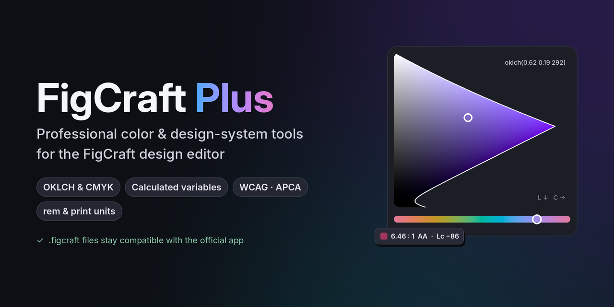
</p>

<p align="center">
  <a href="../../releases/latest"></a>
  &nbsp;
  <a href="ROADMAP.md"></a>
  &nbsp;
  <a href="../../issues/new?template=feature_request.yml"></a>
</p>

<p align="center">
  <b>FigCraft Plus 11</b> · built on FigCraft <b>v0.13.1</b>, the latest official release ·
  <code>.figcraft</code> files stay compatible with the official app, both ways
</p>

**FigCraft Plus turns [FigCraft](https://github.com/storytold/figcraft) into a stronger tool for
color and design systems.** It is applied to every official FigCraft release and built for
Windows automatically: you get the editor you know, with professional tools on top — and nothing
to migrate.

It only adds what FigCraft doesn't have yet. When an official release ships a feature of its own,
Plus steps aside and uses it ([what has moved into FigCraft](#now-in-figcraft-itself-removed-from-plus)):
the goal is a better FigCraft, not a different one.

## Why FigCraft Plus

<table>
<tr>
<td width="33%" valign="top">

### 🎨 Advanced color

An **OKLCH picker** that shows the real gamut, **CMYK** fields, colors written as **CSS
formulas**, *Copy as* any format, and a **WCAG + APCA contrast check** against what is really
under the layer.

</td>
<td width="33%" valign="top">

### 🧩 Stronger design systems

**Calculated variables** and colors **derived** from others (`oklch(from …)`, `color-mix()`,
`calc()`), channels driven by number variables, **units** (px, rem, mm, cm, in, pt) in every field, style dialogs and
groups, scoped variable pickers, variable ordering.

</td>
<td width="33%" valign="top">

### 🔁 Native file compatibility

Plus never touches FigCraft's file format — the build stops if a change would. Formulas and
settings are kept as text the official app ignores, so files open there with every color and size
as you left it.

</td>
</tr>
</table>

## See it in action

<table>
<tr>
<td width="50%" valign="top">

**OKLCH picker** — lightness and hue move evenly; the plane shows the exact gamut edge.

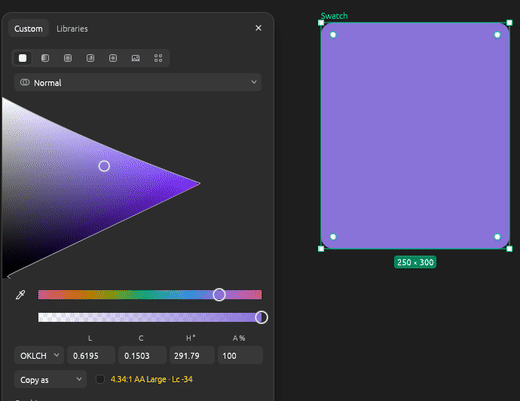

</td>
<td width="50%" valign="top">

**Calculated variables** — change one number, the whole palette follows: hover, transparency,
tint and complement are formulas of `primary`.

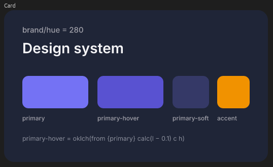

</td>
</tr>
<tr>
<td width="50%" valign="top">

**Contrast that sees the background** — the same white button on three backgrounds: WCAG ratio,
level and APCA Lc update as it moves.

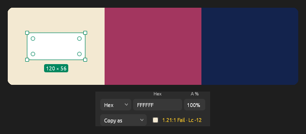

</td>
<td width="50%" valign="top">

**Libraries in the picker** — search the colour variables and apply one; only those scoped to
what you edit are offered.

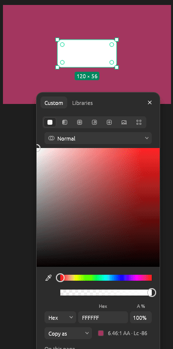

</td>
</tr>
</table>

**Before / after** — the same color in FigCraft's picker and in FigCraft Plus:

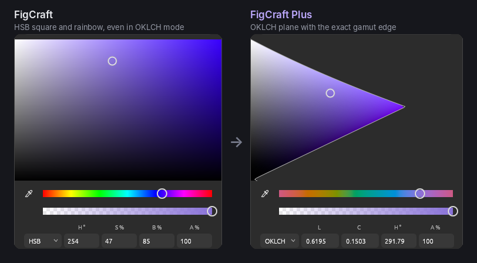

> ### 🔁 Compatibility first
>
> FigCraft Plus extends the editor without a file format of its own. A `.figcraft` file saved by
> Plus is written by FigCraft's own, unchanged code — the build checks that no add-on touches the
> document model or file format, and stops if one would. What Plus adds (formulas, rem settings,
> style groups) is stored as text inside the file, which the official app keeps and ignores: it
> opens the file and shows the last computed colors and sizes. Nothing to convert, in either
> direction.

> ### 🗺 Roadmap — what's next
>
> **Next — after FigCraft 0.14:** sizes in %, vw and vh · auto layout from variables · line height and
> gradients as tokens · **print: a resolution (DPI) per frame** — switch a frame from 72 to 300 and it
> scales with its content, without overlapping its neighbours · PDF/X.
>
> **[See the full roadmap →](ROADMAP.md)** · **[Ask for a feature →](../../issues/new?template=feature_request.yml)**
> — the most 👍-ed requests move up.

## Contents

- [Why FigCraft Plus](#why-figcraft-plus) · [See it in action](#see-it-in-action) · [Roadmap](ROADMAP.md) · [Changelog](CHANGELOG.md)
- [Download and update](#download-and-update)
- [Feature comparison](#feature-comparison)
- [Requested in FigCraft's issues, made here](#requested-in-figcrafts-issues-made-here)
- [Now in FigCraft itself (removed from Plus)](#now-in-figcraft-itself-removed-from-plus)
- [Add-ons](#add-ons)
  - [OKLCH, done the oklch.com way](#oklch-done-the-oklchcom-way)
  - [Derived colours and calculated variables](#derived-colours-and-calculated-variables)
  - [Units everywhere: px, rem, mm, cm, in, pt](#units-everywhere-px-rem-mm-cm-in-pt)
  - [CMYK and Copy as in the colour picker](#cmyk-and-copy-as-in-the-colour-picker)
  - [Contrast both ways: WCAG and APCA](#contrast-both-ways-wcag-and-apca)
  - [Colour variables in the picker: the Libraries tab](#colour-variables-in-the-picker-the-libraries-tab)
  - [FigCraft Plus preferences](#figcraft-plus-preferences)
  - [A better picker](#a-better-picker)
  - [A picker that stays with what you're editing](#a-picker-that-stays-with-what-youre-editing)
  - [Colours driven by number variables](#colours-driven-by-number-variables)
  - [Variables in text: weight, paragraph spacing and indent](#variables-in-text-weight-paragraph-spacing-and-indent)
  - [Your own fonts, travelling with the app](#your-own-fonts-travelling-with-the-app)
  - [Styles: create and edit them in a dialog](#styles-create-and-edit-them-in-a-dialog)
  - [Style groups in Local styles](#style-groups-in-local-styles)
  - [Variable details & scope, one click away](#variable-details--scope-one-click-away)
  - [A richer variable picker](#a-richer-variable-picker)
  - [Reorder variables: drag & drop and sorting](#reorder-variables-drag--drop-and-sorting)
  - [Design System Inspector](#design-system-inspector)
  - [Variables as CSS for code, and from CSS](#variables-as-css-for-code-and-from-css)
  - [Text styles together](#text-styles-together)
  - [Missing fonts: replace, and remember](#missing-fonts-replace-and-remember)
- [Community](#community)
- [FAQ](#faq)
- [How it works](#how-it-works)
  - [Run a build by hand](#run-a-build-by-hand)
  - [Build locally](#build-locally)
  - [When FigCraft adds a feature of its own](#when-figcraft-adds-a-feature-of-its-own)
  - [Add a feature](#add-a-feature)
- [License](#license)

## Feature comparison

**🟣 Exclusive** — FigCraft has nothing like it yet. **🔵 Enhanced** — FigCraft has a basic
version; Plus goes further. Features FigCraft has since added itself are
[listed separately](#now-in-figcraft-itself-removed-from-plus) — they are no longer part of Plus.

| Feature | In FigCraft v0.13.1 | In FigCraft Plus | |
|---|---|---|---|
| [OKLCH, done the oklch.com way](#oklch-done-the-oklchcom-way) | FigCraft has OKLCH fields: lightness in percent, sRGB only, and the HSB square and rainbow stay HSB. | The whole picker works in OKLCH (an OKLCH plane with the exact gamut edge, an OKLCH hue strip), values match oklch.com and CSS, and Display P3 files are read in P3. | 🔵 Enhanced |
| [Derived colours and calculated variables](#derived-colours-and-calculated-variables) | A variable can be an *alias* of another — an exact copy, nothing more. | A colour can be *made from* another (transparency, lighter / darker, its complement, a mix of two), and a number from other numbers, all kept in step in every mode. | 🟣 Exclusive |
| [Units everywhere: px, rem, mm, cm, in, pt](#units-everywhere-px-rem-mm-cm-in-pt) | Everything is shown and typed in px; mm, cm and in only in the PDF export's settings; Dev Mode rem uses a fixed 16. | Each file picks a **layout** unit (px, rem, mm, cm, in, pt) and a **text** unit (px, rem, pt) with its own root size; every field, the rulers, Dev Mode and number variables show it, and any field takes any unit (`210mm`, `1.5rem`, `1.5em`, `10mm + 2`). | 🟣 Exclusive |
| [CMYK and Copy as in the colour picker](#cmyk-and-copy-as-in-the-colour-picker) | The picker offers Hex, RGB, HSL, HSB, LCH, OKLCH and CSS; CMYK exists only as a PDF export option. | **CMYK** fields in the picker, and **Copy as** — the colour in any format, one click. | 🟣 Exclusive |
| [Contrast both ways: WCAG and APCA](#contrast-both-ways-wcag-and-apca) | No contrast check in the interface. | Under the picker's fields, two `Aa` samples — the colour on what is really under the layer, and that background on the colour — each with the WCAG ratio and level and the APCA Lc; the better pairing is marked. | 🟣 Exclusive |
| [Colour variables in the picker: the Libraries tab](#colour-variables-in-the-picker-the-libraries-tab) | Colour variables are applied from the style menu next to Fill or Stroke; the picker itself only edits a colour. | A **Libraries** tab beside **Custom** in the colour picker: this file's and the enabled libraries' colour variables, with search — only those whose scope fits what you edit (a stroke offers stroke colours). | 🔵 Enhanced |
| [FigCraft Plus preferences](#figcraft-plus-preferences) | The colour picker always opens in Hex; there are no units to choose. | Preferences ▸ FigCraft Plus: the layout and text units and root size for new files, decimals shown, the model the colour picker opens in, and whether the picker follows the selection. | 🟣 Exclusive |
| [A better picker](#a-better-picker) | Fields without captions, one fixed width. | A caption over every field, a width that fits the model, and a draggable edge. | 🔵 Enhanced |
| [A picker that stays with what you're editing](#a-picker-that-stays-with-what-youre-editing) | The picker opens beside the Design panel and closes when the selection changes. | It moves to the same slot of the newly selected layer, so you keep editing without reopening it; opened from a style dialog, it opens beside the dialog. | 🔵 Enhanced |
| [Colours driven by number variables](#colours-driven-by-number-variables) | A colour can be bound to a colour variable as a whole. | Each channel (L, C, H, R, G, B, H, S, alpha…) can follow its own number variable: one `brand/hue` restyles every colour built on it. | 🟣 Exclusive |
| [Variables in text: weight, paragraph spacing and indent](#variables-in-text-weight-paragraph-spacing-and-indent) | Font family and font style take string variables. | The weight takes a number variable too (400, 700), and paragraph spacing and indent take number variables. | 🔵 Enhanced |
| [Your own fonts, travelling with the app](#your-own-fonts-travelling-with-the-app) | Fonts come from the system (and Adobe Fonts / font managers on macOS). | A `fonts` folder next to `figcraft.exe` — your fonts travel on the USB drive — with *Add fonts…*, an *In this file* section and *Added* tags. | 🟣 Exclusive |
| [Styles: create and edit them in a dialog](#styles-create-and-edit-them-in-a-dialog) | Styles are created from the selection and edited in FigCraft's style popover. | A **+** on Local styles creates any kind of style from scratch in a dialog with a live preview, with variables in effect, grid and colour fields too. | 🔵 Enhanced |
| [Style groups in Local styles](#style-groups-in-local-styles) | Local styles are grouped by the folders in their names. | Real nested groups: Ctrl+G, New group, drag styles and groups, collapse, rename, ungroup. | 🔵 Enhanced |
| [Variable details & scope, one click away](#variable-details--scope-one-click-away) | Right-click a variable ▸ Edit variable. | An *Edit variable* button on every row, opening beside the editor and following it. | 🔵 Enhanced |
| [A richer variable picker](#a-richer-variable-picker) | A plain list of the variables that fit. | One card everywhere: search, library filter, collections and groups, swatches and values, arrow keys and Enter. | 🔵 Enhanced |
| [Design System Inspector](#design-system-inspector) | No check of the design system as a whole. | One list of what keeps it from holding together — values typed by hand that a variable holds, broken references, circular formulas, unused, unscoped and duplicate variables — each jumping to its layer or variable, most with a one-click fix. | 🟣 Exclusive |
| [Variables as CSS for code, and from CSS](#variables-as-css-for-code-and-from-css) | Variables export as CSS in hex and px (formulas flattened) and import from JSON. | **CSS for code:** `oklch()`, `rem`, relative colours, `color-mix()`, `calc()`; and **import CSS custom properties** — `:root` and theme blocks as modes. | 🔵 Enhanced |
| [Text styles together](#text-styles-together) | Text styles are edited one at a time. | Select several: set font, size, line height, letter spacing for all; bind variables to all of them by name, previewed, one undo step. | 🟣 Exclusive |
| [Missing fonts: replace, and remember](#missing-fonts-replace-and-remember) | Missing fonts are listed and the font store's ones downloaded. | **Replace…** with an installed font — every run and text style — remembered for the next file that uses it. | 🔵 Enhanced |
| [Reorder variables: drag & drop and sorting](#reorder-variables-drag--drop-and-sorting) | Modes can be reordered; variables keep the order they were made in. | Drag variables, groups and collections, multi-select, Alt+↑/↓, and natural or by-value sorting — also as commands for scripts and MCP. | 🟣 Exclusive |

Everything stays a normal `.figcraft` file: the official app opens it and sees the last computed
colours and sizes; formulas and settings are kept as text it ignores.

## Download and update

1. Open **[Releases](../../releases/latest)** and take
   `figcraft-plus-<n>-figcraft-<version>-windows-x64-portable.zip`.
2. Unzip it anywhere (a USB drive works) and run `figcraft.exe`. Nothing is installed.
3. The build isn't code-signed: if Windows SmartScreen warns, choose **More info → Run anyway**.

**Updating** to a newer Plus: unzip the new release over the old folder (or into a new one and
copy your `fonts` folder and `figcraft-plus.json` across). Your `.figcraft` files live wherever
you saved them and need nothing — every Plus version, and the official app, opens them.

To hear about new builds, use **Watch → Custom → Releases** on this page; what changed is in the
[changelog](CHANGELOG.md).

The build is FigCraft from the same release tag, built the same way (release profile, static C
runtime, embedded fonts, `figcraft-cli.exe` included), plus the add-ons below.

## Requested in FigCraft's issues, made here

Features FigCraft users asked for in the official tracker that FigCraft itself hasn't taken up:

| Request | In FigCraft Plus |
|---|---|
| [storytold/figcraft#1280 — Variable Referencing](https://github.com/storytold/figcraft/issues/1280) | 2 — [derived colours and calculated variables](#derived-colours-and-calculated-variables) |
| [storytold/figcraft#1325 — REM as a typography input unit, with a configurable root size](https://github.com/storytold/figcraft/issues/1325) | 2 — [rem units](#units-everywhere-px-rem-mm-cm-in-pt); 7 — every unit, everywhere |

## Now in FigCraft itself (removed from Plus)

| Was in Plus | In FigCraft since |
|---|---|
| Spacing field for several layers in a row or column | 0.7 — smart-selection spacing, with handles on the canvas |
| OKLCH in the colour picker's model menu | 0.12 — LCH and OKLCH models |
| Font family and font style bound to string variables | 0.12 |
| Colour variables offered by fill / stroke scope in the style picker | 0.12 |
| One popover style (header, close button, shadow), closed by Escape and a press outside | 0.13 — FigCraft's own popover, which Plus's popovers now use |
| The colour picker opening beside the Design panel, at the swatch's height | 0.13 |
| The style menu restyled light in the light theme | 0.13 keeps its dark style menu; Plus no longer recolours it |
| Google Fonts download | removed earlier (fonts folder instead) |

## Add-ons

### OKLCH, done the oklch.com way

**🔵 Enhanced** — better in FigCraft Plus

> **FigCraft:** FigCraft has OKLCH fields: lightness in percent, sRGB only, and the HSB square and rainbow stay HSB.
>
> **FigCraft Plus:** The whole picker works in OKLCH (an OKLCH plane with the exact gamut edge, an OKLCH hue strip), values match oklch.com and CSS, and Display P3 files are read in P3.

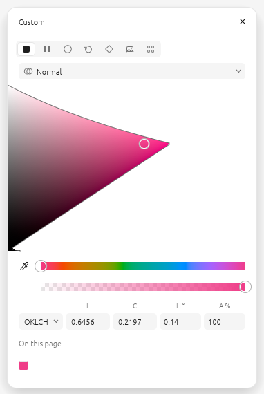

| Field | Meaning | Range |
|---|---|---|
| **L** | lightness | 0–1 |
| **C** | chroma | 0–0.4 |
| **H** | hue | degrees |

- Same units and precision as [oklch.com](https://oklch.com) and CSS `oklch(L C H)`: paste a hex
  copied from FigCraft into oklch.com and you get the same numbers. Fields also take CSS forms
  (`64.56%` for L, `55%` for C = 0.22).
- Values are read and written in the **file's colour profile** (sRGB or Display P3,
  File ▸ Color profile). Colours outside the gamut are mapped in with the CSS Color 4 algorithm
  (chroma reduced, lightness and hue kept).
- The whole picker works in OKLCH: the HSB square becomes an **OKLCH plane** (chroma across,
  lightness down, at the current hue) with the exact gamut edge — and, in a Display P3 file, the
  sRGB edge dashed — and the rainbow becomes an **OKLCH hue strip** at the current lightness and
  chroma, so dragging the hue keeps the lightness.
- Verified against the [coloraide](https://github.com/facelessuser/coloraide) reference
  implementation (CSS Color 4) on 6,000 colours: largest difference 0.000001.

### Derived colours and calculated variables

**🟣 Exclusive** — only in FigCraft Plus (for now)

> **FigCraft:** A variable can be an *alias* of another — an exact copy, nothing more.
>
> **FigCraft Plus:** A colour can be *made from* another (transparency, lighter / darker, its complement, a mix of two), and a number from other numbers, all kept in step in every mode.

*Requested in [storytold/figcraft#1280](https://github.com/storytold/figcraft/issues/1280).*

A colour can be made from another one, in CSS's own syntax, and stays in step with it — in every
mode (Light / Dark), and down a chain (a hover from a faded colour from the brand colour):

| Typed | Gives |
|---|---|
| `oklch(from {Brand/Primary} l c h / 50%)` | the brand colour, half transparent |
| `oklch(from {Brand/Primary} calc(l - 0.08) c h)` | a darker hover |
| `oklch(from {Brand/Primary} l c calc(h + 180))` | its complement |
| `color-mix(in oklch, {Brand/Primary} 20%, {Surface})` | a tint of the surface |
| `hsl(from #3A81F6 h s calc(l * {Shade}))` | a fixed colour, shaded by a number variable |

- **Type it into the colour picker's CSS field** (the model menu's last entry) — for a colour
  variable, a style's paint or a layer's fill, stroke, gradient stop or effect. The picker shows
  the formula under the fields, with a button that detaches it (the colour stays as it is).
- `from` takes a colour variable `{name}` or a hex colour; the model's keywords (`l c h`, `h s l`,
  `h s b`, `r g b`, `alpha`) are the base colour's channels, in the picker's units, and work in
  `calc()` with numbers and number variables. Without `/ alpha` a derived colour keeps its base's
  alpha.
- `color-mix` mixes in `oklch`, `hsl`, `hsb` or `srgb`, hues the shorter way round; editing a mixed
  colour by hand detaches it.

**Number variables from other number variables:** a line `calc({Space/Base} * 2)` in a number
variable's description keeps its value at twice `Space/Base`, in every mode. Editing the value by
hand detaches it; variables that read each other in a loop are left as they are.

The formulas live in the descriptions (and layer data) as text, so the official FigCraft opens
the files and keeps the last computed values.

### Units everywhere: px, rem, mm, cm, in, pt

**🟣 Exclusive** — only in FigCraft Plus (for now)

> **FigCraft:** Everything is shown and typed in px; mm, cm and in exist only in the PDF export's print settings, and Dev Mode converts px → rem with a fixed 16.
>
> **FigCraft Plus:** Each file chooses the unit its fields show — one for **layout** (px, rem, mm, cm, in, pt) and one for **text** (px, rem, pt) — with its own root size. Every number field shows and takes it, and any field takes any unit typed by hand.

*rem requested in [storytold/figcraft#1325](https://github.com/storytold/figcraft/issues/1325).*

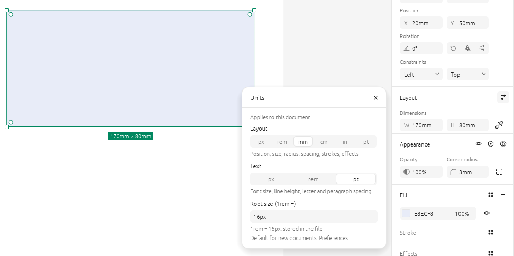

**Where to set it**

| What | Where |
|---|---|
| This file's units and root size | **Units** — the gear in the **Layout** or **Typography** header, or the **Units** row of the Page section (nothing selected) |
| The units and root size for new files | **Preferences ▸ FigCraft Plus** ▸ *Layout unit*, *Text unit*, *Default root size* |

- **Layout unit** — position, width and height, min / max, corner radius, gap and padding, stroke
  weights and dashes, shadow offsets, blur and spread, layout grid sizes, vector points, the
  spacing between selected layers; also the selection's size on the canvas and the measurements.
  Lay out a print page in **mm**, a web page in **rem**.
- **Text unit** — font size, line height, letter spacing, paragraph spacing and indent, list
  spacing: **pt** for print, **rem** for the web.
- **Switch units from any field:** a length field names its unit right after its value — click
  it — or **right-click** any length field (the way in px, where fields look and behave exactly as
  FigCraft's). The list switches the **document's** unit — layout or text — and *Units settings…*
  opens the rest. One unit per document, never one per property: the file stays plain px.

  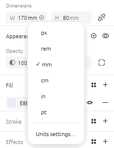
- **Any field takes any unit** typed with the number, whatever it shows: `210mm`, `5.5cm`, `1in`,
  `12pt`, `1.5rem`, `24px`, and arithmetic across them (`10mm + 2`, `2rem + 4`).
- A px is a point (1/72 in), as FigCraft's own print export reads it: a frame of `210mm` × `297mm`
  exports as an exact A4 page, `85mm` × `55mm` as a business card. rem is the file's root size.
- Values are stored in px, as FigCraft stores them; the units and root size are kept in the file as
  text the official FigCraft ignores, so it opens the file as before (and shows px).
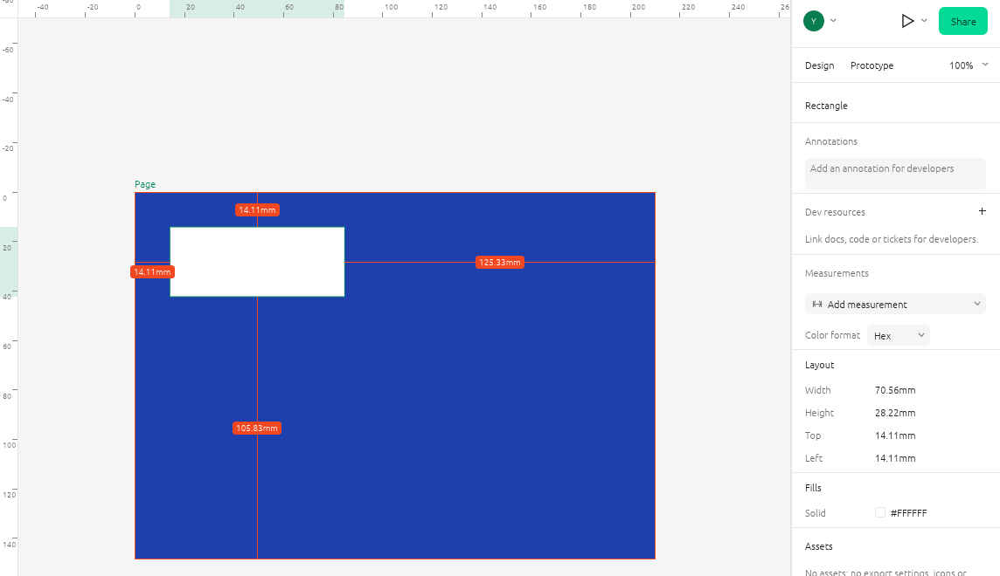

- **Rulers** tick on round numbers of the layout unit (every 10 mm, every 0.5 in), and guides
  show their position in it.
- **Dev Mode in two units:** the properties it lists show the document's units (and copy as
  shown); the code it generates keeps its own unit — px or rem, of the file's root size, stored
  in the file — so a CSS file in millimetres never happens by accident.
- **Number variables** show the unit of what they size in the Variables editor: one bound to (or
  scoped for) sizes, spacing, radius or strokes the layout unit, one for type the text unit;
  opacity, weight and plain numbers stay bare. The variable list shows numbers in the unit of the
  field they would bind to. The stored value never changes.
  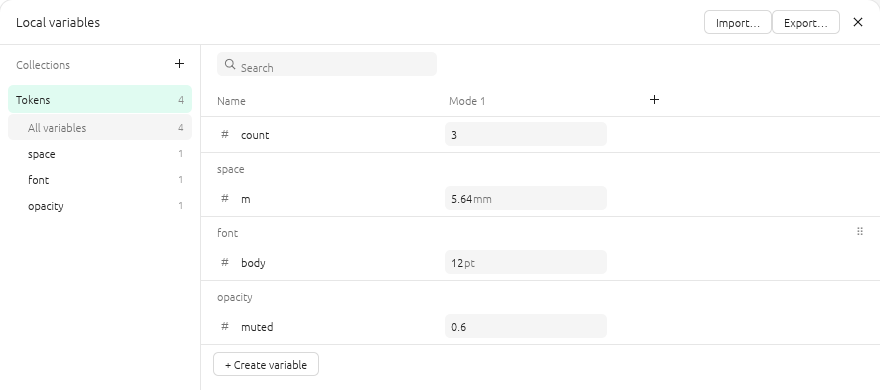
- **em** for line height and letter spacing: `1.5em` is 150%, `0.02em` is 2% — relative to the
  font size, as in CSS, stored as FigCraft's percentage.
- **Coming later:** `%`, `vw` and `vh` — sizes relative to the parent frame
  ([roadmap](ROADMAP.md)).

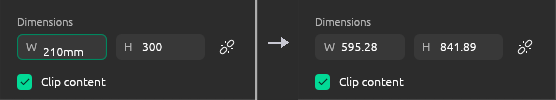

### CMYK and Copy as in the colour picker

**🟣 Exclusive** — only in FigCraft Plus (for now)

> **FigCraft:** The picker offers Hex, RGB, HSL, HSB, LCH, OKLCH and CSS; CMYK exists only as a PDF export option.
>
> **FigCraft Plus:** **CMYK** fields in the picker, and **Copy as** — the colour in any format, one click.

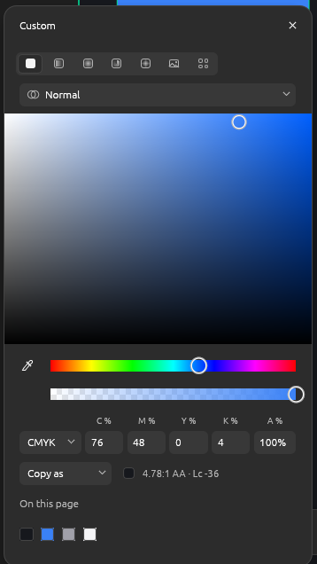

- **CMYK** in the model menu: C, M, Y and K in percent. They are converted exactly the way
  FigCraft's CMYK PDF export converts (`K = 1 − max(R, G, B)`), so what you see is what the PDF
  holds. (It's the profile-free formula: proof against your print shop's profile for production.)
- Want the picker to always open in CMYK (or OKLCH)? **Preferences ▸ FigCraft Plus ▸ Colour picker
  opens in**.
- **Copy as** under the fields: Hex, `rgb()`, `hsl()`, HSB, `lch()`, `oklch()` (oklch.com
  precision), `device-cmyk()` or CSS — a converter between colour spaces.

### Contrast both ways: WCAG and APCA

**🟣 Exclusive** — only in FigCraft Plus (for now)

> **FigCraft:** No contrast check in the interface.
>
> **FigCraft Plus:** Under the picker's fields, two `Aa` samples — the colour on what is really under the layer, and that background's colour on the colour — each with the WCAG 2 ratio and level and the APCA Lc. The pairing that reads better is marked.

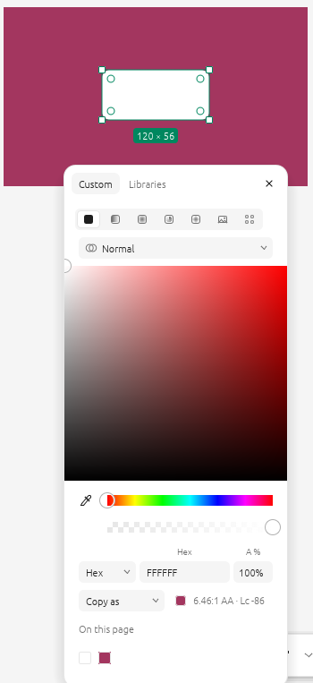

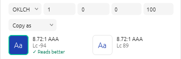

- **The backdrop is what is really under the layer**, at its centre: any shape, frame or
  gradient behind it (a button on a coloured rectangle is checked against the rectangle, not the
  page), hidden and clipped-away layers left out. Half-transparent layers are blended in, down to
  the first opaque one and the page's background. Hover a sample to see the colour it found.
- **Both ways:** WCAG gives the same ratio whichever colour is the text; APCA doesn't — light text
  on dark reads differently from dark text on light — so the sample with the larger |Lc| is marked
  *Reads better*. A quick way to see whether swapping foreground and background would help.
- WCAG levels for normal text: **AAA** ≥ 7, **AA** ≥ 4.5, **AA Large** ≥ 3; below 4.5 the line is
  shown in the warning colour. APCA Lc follows APCA-W3 (black on white ≈ 106, white on black ≈ −108).

### Colour variables in the picker: the Libraries tab

**🔵 Enhanced** — better in FigCraft Plus

> **FigCraft:** Colour variables are applied from the style menu next to Fill or Stroke; the picker itself only edits a colour.
>
> **FigCraft Plus:** A **Libraries** tab beside **Custom** in the colour picker: this file's and the enabled libraries' colour variables, with search — only those whose scope fits what you edit.

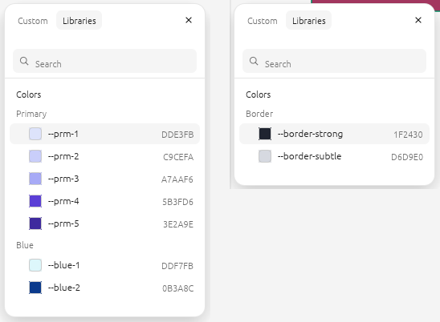

- **Only variables whose scope fits** are listed: a fill lists the variables scoped to frame,
  shape or text fills (by what the layer is), a stroke those scoped to strokes, a shadow's colour
  those scoped to effects. Set a variable's scope in **Variables ▸ Edit variable**; with nothing
  fitting, the tab says so.
- Collections and groups as headers, the swatch and value of each colour, **search**, a library
  filter, arrow keys and Enter. The variable in use is checked; a click applies it.
- Works for a layer's fills, strokes and effect colours, a colour style's paint, and a colour
  variable's value in the Variables editor (it becomes an alias; variables that would loop are left
  out).
- The picker opens on the tab you used last.

### FigCraft Plus preferences

**🟣 Exclusive** — only in FigCraft Plus (for now)

> **FigCraft:** The colour picker always opens in Hex; there is no typography unit to choose.
>
> **FigCraft Plus:** **Preferences ▸ FigCraft Plus**: the layout and text units and the root size for new files, and the model the colour picker opens in.

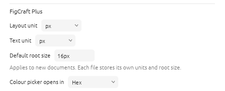

| Setting | What it does |
|---|---|
| **Layout unit** — px, rem, mm, cm, in or pt | The unit layout fields show in files that don't set their own (Units) |
| **Text unit** — px, rem or pt | The unit text fields show in files that don't set their own |
| **Default root size** | 1rem in files that don't set their own |
| **Decimals shown** — 0 to 4 | How many decimals fields show; values keep every digit |
| **Colour picker opens in** — Hex, RGB, HSL, HSB, LCH, OKLCH, CMYK or CSS | The model the picker shows when it opens |
| **Picker follows the selection** — on by default | Clicking another layer keeps the colour picker open on the same fill, stroke or effect; off, it closes as FigCraft's |

They are saved in `figcraft-plus.json` next to `figcraft.exe`, so a copy on a USB drive keeps them.

### A better picker

**🔵 Enhanced** — better in FigCraft Plus

> **FigCraft:** Fields without captions, one fixed width.
>
> **FigCraft Plus:** A caption over every field, a width that fits the model, and a draggable edge.

- **Captions over every field** in every model (R G B, H S L, H S B, L C H, A).
- **Width adapts** to the chosen model; drag the picker's **left edge** to make it wider
  (double-click the edge to reset).

### A picker that stays with what you're editing

**🔵 Enhanced** — better in FigCraft Plus

> **FigCraft:** The picker opens beside the Design panel at the swatch's height, and closes when the selection changes.
>
> **FigCraft Plus:** It moves to the same slot of the newly selected layer, so you keep editing without reopening it.

- **Select another layer** (click it on the canvas or in Layers) and it switches to the same slot
  of that layer — Fill 1 stays Fill 1, the second shadow stays the second shadow. If the layer has
  no such slot, or nothing is selected, it closes as FigCraft's does. A click that selects nothing
  new closes it; dragging (moving layers, gradient handles) leaves it open.
- **Not for you?** Turn off **Preferences ▸ FigCraft Plus ▸ Picker follows the selection**: the
  picker then closes on any press outside it and on every change of selection, exactly as
  FigCraft's.
- **Opened from a style dialog**, it opens beside the dialog instead of over it.
- Where it opens otherwise, Escape and a press outside closing it are FigCraft's own (since 0.13).

### Colours driven by number variables

**🟣 Exclusive** — only in FigCraft Plus (for now)

> **FigCraft:** A colour can be bound to a colour variable as a whole.
>
> **FigCraft Plus:** Each channel (L, C, H, R, G, B, H, S, alpha…) can follow its own number variable: one `brand/hue` restyles every colour built on it.

<p>
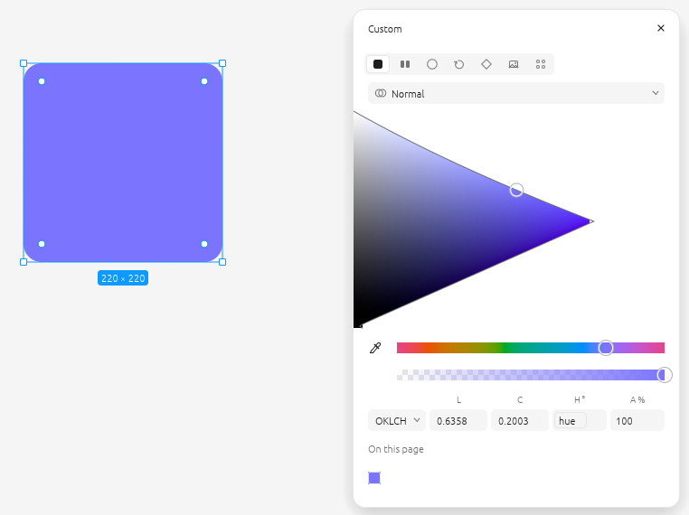
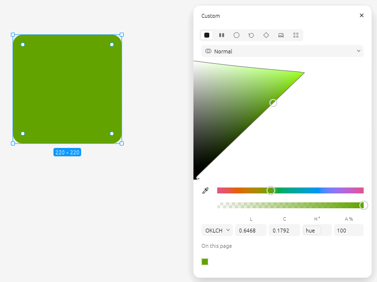
</p>

*Left: H is bound to `brand/hue` = 280. Right: the variable set to 130 — the card follows.*

Every channel of a colour can be bound to a number variable, right in the picker — just like
FigCraft's own number fields. Hover a field in the **RGB**, **HSL**, **HSB** or **OKLCH** row
(R G B, H S L, H S B, L C H, and alpha **A**): the variable button appears at its right end. Pick
a number variable and the field shows its name; the detach button turns it back into a number.

Bind H to `brand/hue = 280`, change the variable to 130, and every colour linked to it follows —
layers, styles and variables — in one undo step.

**How to bind a channel**

1. Open the picker and choose RGB, HSL, HSB or OKLCH. Hover a field: the variable button appears.

   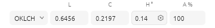

2. Click it and pick a number variable (grouped by collection).

   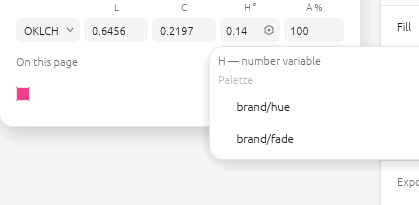

3. The field now shows the variable's name. Alpha binds the same way — here H follows
   `brand/hue` and A follows `brand/fade` = 60%.

   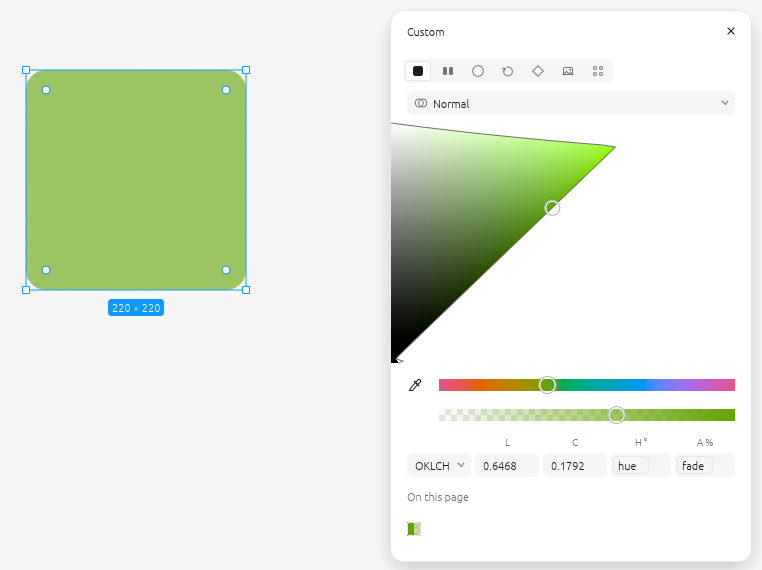

4. To unbind, hover the name and click the detach button at its right; the field gets its
   current value back.

Switching to another model shows which channels are linked elsewhere; binding in the current
model replaces those links.

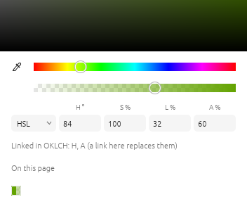

- Works wherever the picker edits a colour: layer fills and strokes, **gradient stops**, effect
  colours (shadows, noise), the **page background**, **colour styles** and **colour variables**.
  (Not yet: a range of characters inside a text layer, plugin colour fields.)
- Each model binds in its own terms: H in OKLCH is OKLCH hue, H in HSL is HSL hue. A colour is
  linked in one model at a time; the picker notes links made in another model, and binding in the
  current one replaces them.
- Units are the fields': OKLCH L 0–1 (a variable above 1 is read as a percentage), C 0–0.4,
  H degrees; HSL / HSB H degrees, S L B 0–100; RGB 0–255; alpha 0–100.
- Variables are read in the modes that apply where the colour is: a layer's frames (switch a
  frame to Dark and its layers re-read Dark values), a colour variable's own collection mode;
  styles use the default modes.
- Editing the colour itself (hex, square, eyedropper) updates the unbound channels; bound ones
  stay bound.
- The links are stored as text — a layer's data `figcraftplus.colors`, or a line in a style's or
  colour variable's description, e.g. `fills/0 oklch(0.62 0.19 {brand/hue} / {fade})`. Variables
  are referred to by name: rename one → update the name in the line too. The official FigCraft
  opens such files fine and keeps the last computed colours.

### Variables in text: weight, paragraph spacing and indent

**🔵 Enhanced** — better in FigCraft Plus

> **FigCraft:** Font family and font style take string variables.
>
> **FigCraft Plus:** The weight takes a number variable too (400, 700), and paragraph spacing and indent take number variables.

<p>
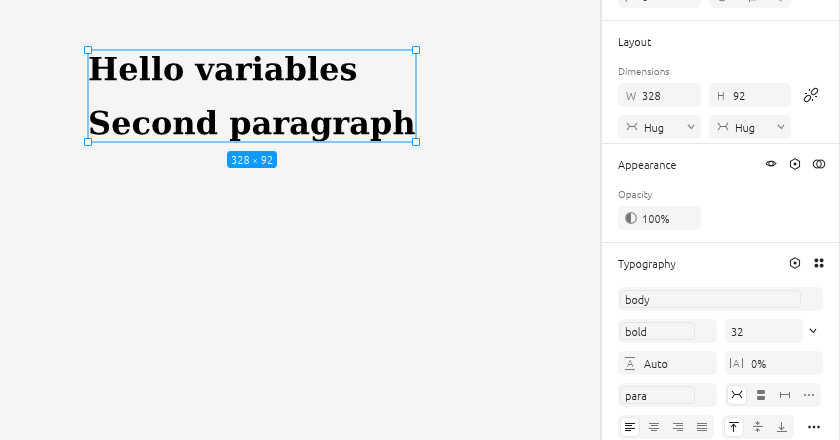
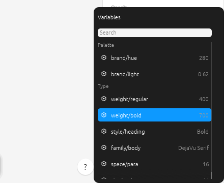
</p>

FigCraft binds the font family and font style to string variables. FigCraft Plus binds the rest of
the Typography section:

| Field | Variable | Example |
|---|---|---|
| **Font style / weight** | a **number** (the weight) as well as a string (the style) | `weight/bold` = 700 |
| **Paragraph spacing** | number | `space/para` = 16 |
| **Paragraph indent** (Typography ▸ …) | number | `space/indent` = 24 |

- *Apply variable* in the font style menu lists **both** kinds: a number sets the weight (the
  nearest style the font has is used), a string sets the style by name. Binding one replaces the
  other in one undo step.
- Variables follow their modes like everywhere else (e.g. a Mobile mode with a smaller paragraph
  spacing), and lists respect each variable's **scopes**.
- While editing a range of characters these fields take plain values (bindings are per layer).

### Your own fonts, travelling with the app

**🟣 Exclusive** — only in FigCraft Plus (for now)

> **FigCraft:** Fonts come from the system (and Adobe Fonts / font managers on macOS).
>
> **FigCraft Plus:** A `fonts` folder next to `figcraft.exe` — your fonts travel on the USB drive — with *Add fonts…*, an *In this file* section and *Added* tags.

- Font files (`.ttf`, `.otf`, `.ttc`) in a **`fonts` folder next to `figcraft.exe`** are added at
  start — on a USB drive your fonts travel with the app.
- **Add fonts…** at the top of the font menu copies chosen files into that folder and adds them at
  once; they are tagged *Added* in the list.
- The font menu gains an **In this file** section (the families the open file uses), between
  FigCraft's *Recent* and *All fonts*.

### Styles: create and edit them in a dialog

**🔵 Enhanced** — better in FigCraft Plus

> **FigCraft:** Styles are created from the selection and edited in FigCraft's style popover.
>
> **FigCraft Plus:** A **+** on Local styles creates any kind of style from scratch in a dialog with a live preview, with variables in effect, grid and colour fields too.

<p>
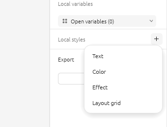
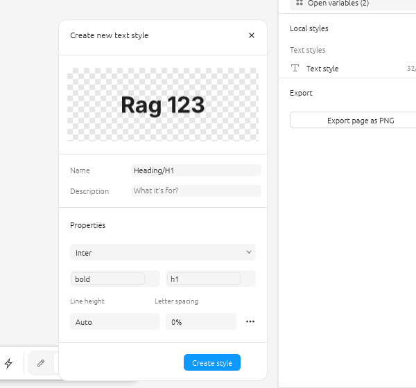
</p>
<p>
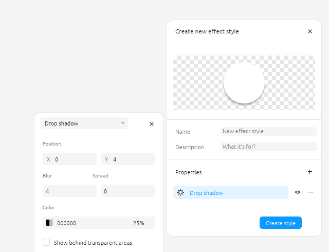
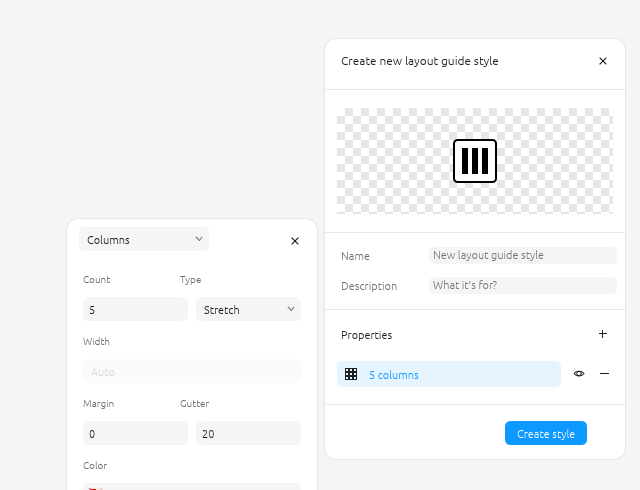
</p>
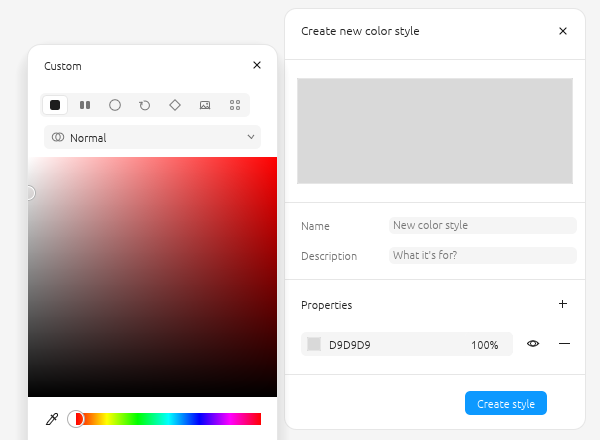

The **Local styles** header (Design panel, nothing selected) has a **+**: choose **Text**,
**Color**, **Effect** or **Layout grid** and the **Create new … style** dialog opens — a preview,
**Name** and **Description**, and **Properties**:

- **Text** — font, style (or weight), size, line height, letter spacing, and under **…**
  decoration and case.
- **Color** — its paints: click the swatch for the full colour picker (solid, gradients, image…,
  OKLCH); hex and opacity in the row; **+** adds a paint.
- **Effect** — a row per effect; click it for its settings beside the dialog: the **type**
  (Drop shadow, Inner shadow, Layer blur, Background blur, Noise, Texture, Glass), position,
  blur, spread, colour, "show behind transparent areas"… **+** adds an effect.
- **Layout grid** — a row per grid; its settings: **Grid / Columns / Rows**, size or count, type
  (Stretch, Left, Center, Right), width, margin, gutter, colour. **+** adds a grid.

Every row has a visibility toggle and **−**. **Create style** keeps the style; the cross (or Esc)
drops it. Click a style in Local styles — or **+** and edit in a layer's style list — to open the same
dialog (**Edit … style**; a style made from a layer opens as **Create new … style**) — changes
apply as you make them, each one undo step.

**Variables in styles.** Fields a style can bind take a variable (the hexagon on hover):

| Style | Fields |
|---|---|
| Text | font family (string), style or weight (string or number, as in the Typography panel), size, line height, letter spacing (numbers) |
| Color | each solid paint's colour |
| Effect | shadow X, Y, blur, spread, colour; blur radius |
| Layout grid | size, count, margin, gutter |

Layers using the style follow the variables in their own modes (a frame set to Mobile shows the
Mobile size).

### Style groups in Local styles

**🔵 Enhanced** — better in FigCraft Plus

> **FigCraft:** Local styles are grouped by the folders in their names.
>
> **FigCraft Plus:** Real nested groups: Ctrl+G, New group, drag styles and groups, collapse, rename, ungroup.

Styles sit in **nested groups** (kept as `/` in their names, so the official FigCraft reads them as
folders). Click to select (Ctrl/Shift-click for several), double-click to edit; **Ctrl+G** or
*Group* puts the selection in a group, **+ ▸ New group** makes an empty one; drag styles and whole
groups between rows, into a group or out to the top; collapse a group with its arrow, double-click
its name to rename it, ungroup it from its context menu.

### Variable details & scope, one click away

**🔵 Enhanced** — better in FigCraft Plus

> **FigCraft:** Right-click a variable ▸ Edit variable.
>
> **FigCraft Plus:** An *Edit variable* button on every row, opening beside the editor and following it.

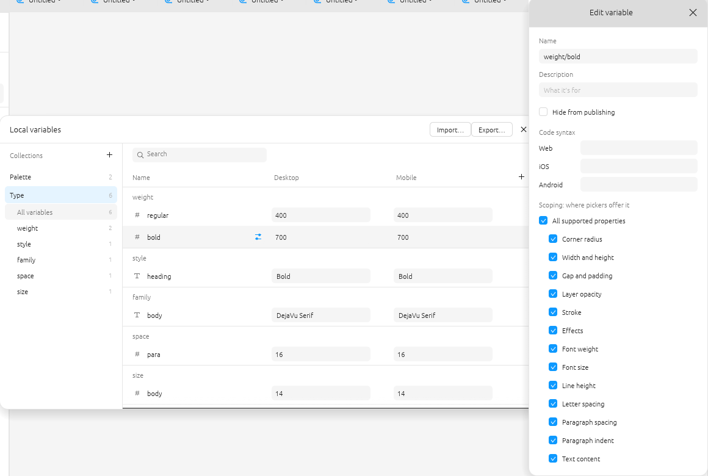

Hover a row in the Variables editor: the **Edit variable** button (two sliders) appears at the end
of the name. It opens the variable's name, description, code syntax and **scoping** — which
properties pickers offer it for (corner radius, gap, font weight, font size, paragraph spacing,
fills, strokes…). The window opens beside the Variables editor at the variable's row, always above
it, and follows the editor when it moves. Click the button again to close. (Right-click ▸ Edit variable still works.)

### A richer variable picker

**🔵 Enhanced** — better in FigCraft Plus

> **FigCraft:** A plain list of the variables that fit.
>
> **FigCraft Plus:** One card everywhere: search, library filter, collections and groups, swatches and values, arrow keys and Enter.

One picker everywhere a variable is applied (layer properties, styles, aliases, prototype
actions, colour channels): search, a library filter, collections and groups as headers, each
variable's swatch or type and its value; arrow keys and Enter work. A variable with every scope
turned off is offered nowhere but the Variables editor, so lists stay short.

### Reorder variables: drag & drop and sorting

**🟣 Exclusive** — only in FigCraft Plus (for now)

> **FigCraft:** Modes can be reordered; variables keep the order they were made in.
>
> **FigCraft Plus:** Drag variables, groups and collections, multi-select, Alt+↑/↓, and natural or by-value sorting — also as commands for scripts and MCP.

Variables, groups and collections keep the order you give them: in the editor, in the file and
in exports. That fixes imports that arrive in the wrong order (`n-xs, n-6xl, n-s, n-m …` or
`1, 10, 2, 3`).

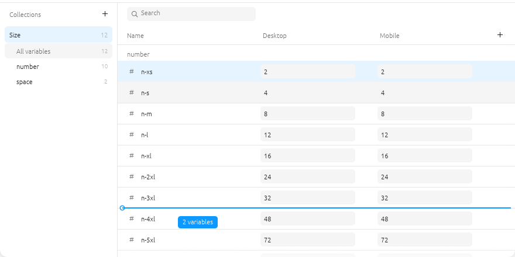

- **Drag a variable** up or down in the table; a blue line shows where it lands. Drop it on
  another group's rows or header to move it into that group (it is renamed `group/name`, e.g.
  `space/gap` → `number/gap`). Variables stay in their collection.
- **Select several**: click, then **Shift**-click for a range or **Ctrl**-click to add or remove
  one; drag any selected row to move them all. **Esc** clears the selection (or cancels a drag).
- **Alt + ↑ / ↓** moves the selected variables one row within their group.
- **Drag a group** by its header in the table or its row in the sidebar (to the top level: drop on
  **All variables**). Subgroups move with it.
- **Drag a collection** in the sidebar.
- **Sort**: right-click a group or a collection in the sidebar.

  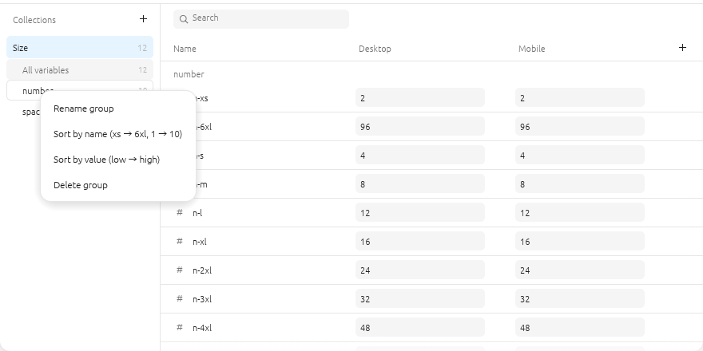
  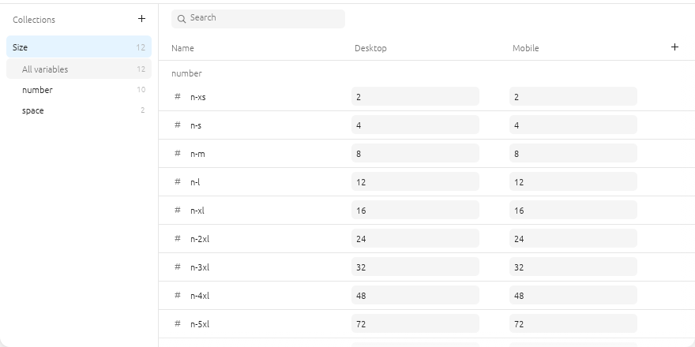

  - **Sort by name** is natural and knows sizes: `xxs, xs, s, m, l, xl, 2xl … 6xl` and
    `1, 2, 10`.
  - **Sort by value** goes low → high: numbers by value, colours light → dark, then text and
    booleans.
  - Groups keep their places; variables are sorted inside each group.
- Each drag, Alt+arrow or sort is one undo step. Read-only libraries can't be reordered.
- The same operations are commands for scripts, the CLI and MCP: `variable.move`,
  `variable.moveGroup`, `variable.moveCollection`, `variable.sort`.

### Design System Inspector

**🟣 Exclusive** — only in FigCraft Plus (for now)

> **FigCraft:** No check of the design system as a whole.
>
> **FigCraft Plus:** **Inspect** in the Variables editor's header lists what keeps the design system from holding together, grouped, each finding one click from its layer or variable, most with a fix.

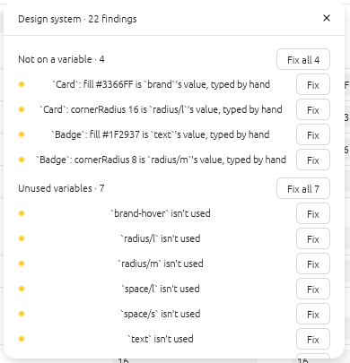

| Finding | Fix |
|---|---|
| **Not on a variable** — a solid fill or stroke, a corner radius, gap, padding, stroke weight or font size typed by hand although a variable holds exactly that value (one scoped for it, or named for it) | Binds it |
| **Broken references** — an alias or a formula reading a variable that's gone; an alias to a variable of another type; a number that isn't finite | — (jump to it) |
| **Circular formulas** — aliases or formulas that read themselves in the end | — |
| **Unused variables** — nothing binds, aliases or reads them | Deletes them |
| **Duplicate tokens** — colours of one collection, or numbers / text of one group, with the same values in every mode | — |
| **Without a scope** — offered for every property | — |

**Fix all** fixes a whole group as one undo step; the list follows every change.

### Variables as CSS for code, and from CSS

**🔵 Enhanced** — better in FigCraft Plus

> **FigCraft:** Variables export as CSS custom properties — colours in hex, sizes in px, calculations flattened to their values — and import from its variables JSON.
>
> **FigCraft Plus:** **Export ▸ CSS for code…** writes them the way code does, and **Import ▸ CSS custom properties…** reads a stylesheet back.

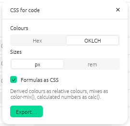

- **Colours** as Hex or `oklch()`; **sizes** in px or `rem` of the file's root size (opacity and
  weights stay bare).
- **Formulas as CSS:** a derived colour as a relative colour —
  `oklch(from var(--brand) calc(l - 0.08) c h)` — a mix as `color-mix()`, a calculated number as
  `calc(var(--space-m) * 2)`, FigCraft's own alpha variants and mixes as CSS too.
- **Import** reads `--name: value` from `:root` (or `@theme`) as the first mode, and every other
  block — `[data-theme="dark"]`, `.dark`, `@media (prefers-color-scheme: dark)` — as a mode named
  after it. Colours (hex, names, `rgb()`, `hsl()`, `oklch()`), lengths (px; rem and em of the
  root size), numbers and font stacks become variables, `var(--x)` an alias, relative colours,
  `color-mix()` and `calc()` calculated variables that follow what they read. `--space-m` lands in
  the group `space` when several properties share the prefix; code keeps the CSS name.

### Text styles together

**🟣 Exclusive** — only in FigCraft Plus (for now)

> **FigCraft:** Text styles are edited one at a time.
>
> **FigCraft Plus:** Select several text styles in Local styles (Ctrl/Shift-click) ▸ right-click ▸ **Edit N text styles…**

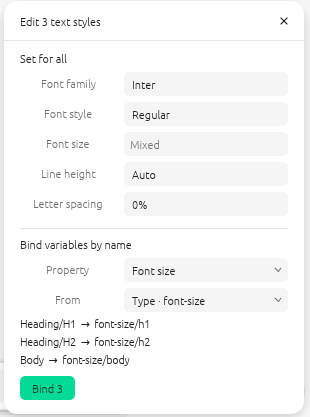

- **Set for all:** font family, style, size, line height, letter spacing. A field shows the shared
  value or *Mixed*; what you type goes to every style as one undo step (`1.4em` works).
- **Bind variables by name:** pick the property (font size, line height, letter spacing, family,
  style) and the group of variables; each style finds the variable of the same name
  (`Heading/H1` ↔ `font-size/h1`), shown before you **Bind**. No guessing between equally good
  names: those stay unmatched.

### Missing fonts: replace, and remember

**🔵 Enhanced** — better in FigCraft Plus

> **FigCraft:** Text ▸ Missing fonts lists the fonts a file uses that aren't installed, and downloads the ones the font store has.
>
> **FigCraft Plus:** **Replace…** each with an installed font, remembered for the next file.

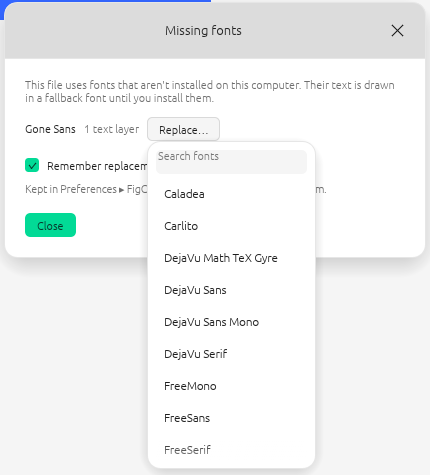

- Every use moves: whole layers, single runs (the other runs keep their fonts), text styles — one
  undo step.
- With **Remember replacements for other files** on, the next file that uses that font gets the
  same replacement as it opens, with a note. **Preferences ▸ FigCraft Plus** lists the remembered
  ones; × forgets one.

## Community

FigCraft Plus grows from what its users need. Every way to take part:

| | |
|---|---|
| 💡 **[Request a feature](../../issues/new?template=feature_request.yml)** | Describe what you want to do and why it helps |
| 👍 **[Vote for features](../../issues?q=is%3Aissue+is%3Aopen+label%3Aenhancement+sort%3Areactions-%2B1-desc)** | A 👍 on a request moves it up the [roadmap](ROADMAP.md) |
| 🐞 **[Report a bug](../../issues/new?template=bug_report.yml)** | Bugs in the add-ons; FigCraft's own bugs go to [its tracker](https://github.com/storytold/figcraft/issues) |
| 🛠 **[Contribute](#add-a-feature)** | Add-ons are small, self-contained files and hooks — see *Add a feature* |
| ⭐ **Star the repository** | It helps others find FigCraft Plus |

## FAQ

<details>
<summary><b>Will my files still open in the official FigCraft?</b></summary>

Yes. Plus doesn't change FigCraft's file format code at all (the build stops if an add-on would),
so a file saved in Plus is written exactly as FigCraft writes it. Formulas, rem settings and style
groups are kept as text the official app keeps and ignores; it shows the last computed colors
and sizes. Files from the official app open in Plus unchanged too.
</details>

<details>
<summary><b>Windows SmartScreen says the app is unrecognised. Is it safe?</b></summary>

The build isn't code-signed, so SmartScreen warns about any new download. It is built in the open
by [GitHub Actions](../../actions) from FigCraft's own release tag plus the files in this
repository — you can read every step in `.github/workflows/build.yml`. Choose **More info → Run
anyway**.
</details>

<details>
<summary><b>How do I update?</b></summary>

Unzip the new release over the old folder. Settings (`figcraft-plus.json`) and your `fonts`
folder sit next to `figcraft.exe`; keep them if you unzip somewhere else.
</details>

<details>
<summary><b>What happens when a new FigCraft version comes out?</b></summary>

The workflow checks for new FigCraft releases every day, applies the add-ons, runs FigCraft's
tests and ours, and publishes a new Plus build — usually within a day. If an add-on no longer
fits the new version, nothing is published and the previous release stays available until it is
fixed. Features FigCraft now has itself are removed from Plus.
</details>

<details>
<summary><b>Is there a macOS or Linux build?</b></summary>

Not yet: builds are Windows-only for now. You can [build it yourself](#build-locally) on any
platform FigCraft supports.
</details>

<details>
<summary><b>Is FigCraft Plus affiliated with FigCraft?</b></summary>

No. It is an independent, community project built on the open-source FigCraft, applied to its
official releases.
</details>

## How it works

```
overlay/          the additions' own files, copied into FigCraft at the same paths
hooks/            where they connect: "insert after this line" / "replace this text"
scripts/apply.py  copies overlay/ and applies hooks/ to a FigCraft checkout
CUSTOM_VERSION    the FigCraft Plus version (bump after changing the additions)
.github/workflows/build.yml   the daily build
```

Every day at 04:17 UTC the workflow checks FigCraft's latest release. If this repository hasn't
built it yet (or the additions changed), it checks the release out, runs `scripts/apply.py`, runs
the additions' tests and publishes `v<figcraft version>-plus.<CUSTOM_VERSION>` under Releases.

If a FigCraft update moves code a hook relies on, the build stops at **Connect custom features**
with the hook named (e.g. `0001-oklch-colour-picker.json #5 (picker: OKLCH fields): no line
matches …`), GitHub e-mails the owner, and the previous release stays available. Fix the hook's
anchor text — usually one line — and the next build goes through.

### Run a build by hand

**Actions → Build FigCraft Plus → Run workflow**. Optionally give a FigCraft tag (e.g.
`v0.6.0`) or tick **force** to rebuild a version that is already released.

### Build locally

```sh
git clone https://github.com/storytold/figcraft
python3 scripts/apply.py figcraft          # --check lists every hook that no longer fits
cd figcraft && cargo run --release -p figcraft
```

### When FigCraft adds a feature of its own

Remove ours: delete its hook (and its `overlay/` files, or the parts of them it no longer needs),
move it to *Now in FigCraft itself* above and bump `CUSTOM_VERSION`.

### Add a feature

1. Put its code in new files under `overlay/` (same paths as in FigCraft).
2. Connect them with a new `hooks/<next number>-….json` (see `0001` for the format).
3. Bump `CUSTOM_VERSION`. Pushing starts a build.

## License

FigCraft is MIT OR Apache-2.0; these additions are offered under the same terms. Not affiliated
with the ArtCraft team. FigCraft is a trademark of its owners.
