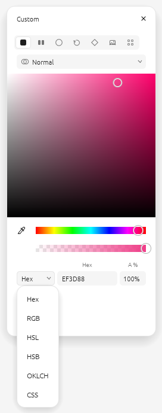
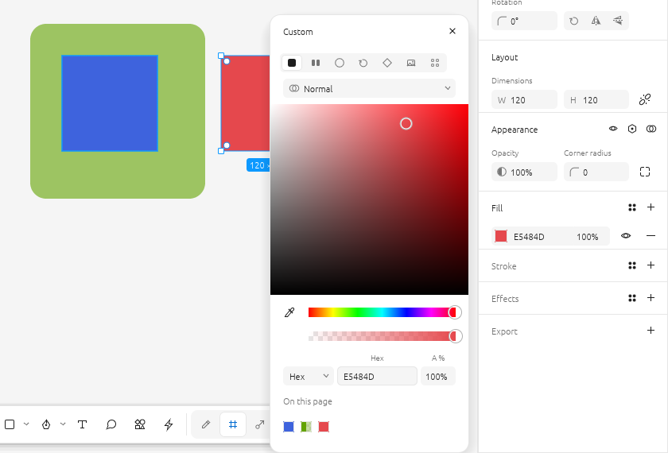
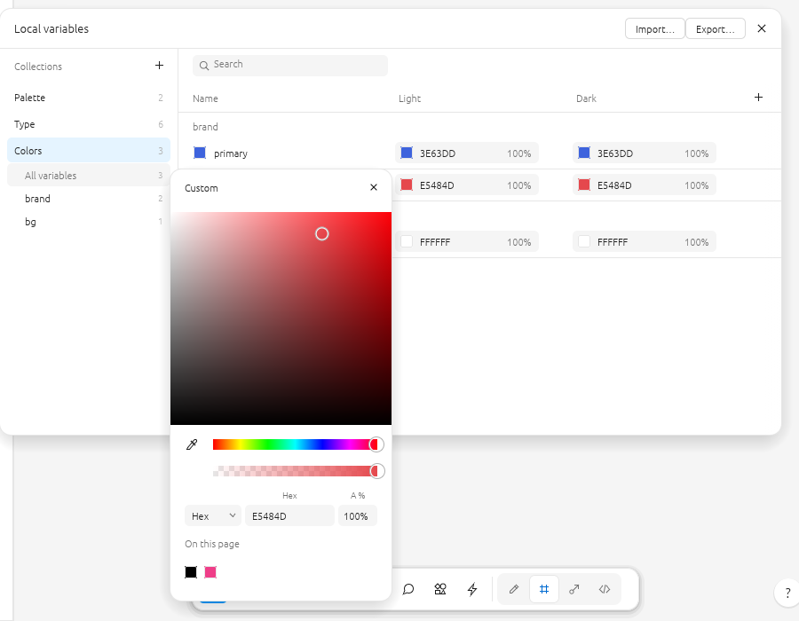
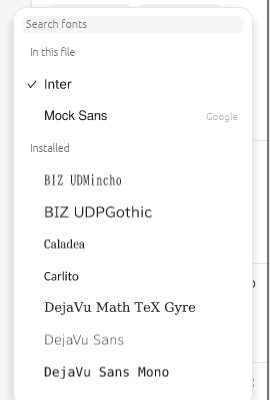
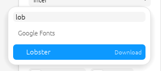

# FigCraft Plus (OKLCH)

**[FigCraft](https://github.com/storytold/figcraft) with extra tools — OKLCH in the colour
picker, a resizable picker with labelled fields that opens beside what you edit, colours driven by number variables, variables
for font family, weight and paragraph spacing, Figma-like style dialogs with variables, Google Fonts, and drag & drop ordering and sorting of
variables.**

This repository holds only the additions. A GitHub Actions workflow takes every new FigCraft
release, applies them, runs the tests and publishes a ready-to-run Windows build under
**[Releases](../../releases)** — usually within a day of the FigCraft release.

## Download

1. Open **[Releases](../../releases)** and take the latest
   `figcraft-<version>-custom.<n>-windows-x64-portable.zip`.
2. Unzip it anywhere (a USB drive works) and run `figcraft.exe`.
3. The build isn't code-signed: if Windows SmartScreen warns, choose **More info → Run anyway**.

To hear about new builds, use **Watch → Custom → Releases** on this page.

The build is FigCraft from the same release tag, built the same way (release profile, static C
runtime, embedded fonts, `figcraft-cli.exe` included), plus the features below. `.figcraft` files
stay fully compatible with the official app in both directions.

## Features

### OKLCH in the colour picker

The picker's model menu gains **OKLCH** (Hex / RGB / HSL / HSB / **OKLCH** / CSS):

<p>


</p>


| Field | Meaning | Range |
|---|---|---|
| **L** | lightness | 0–1 |
| **C** | chroma | 0–0.4 |
| **H** | hue | degrees |

- Same units and precision as [oklch.com](https://oklch.com) and CSS `oklch(L C H)`: paste a hex
  copied from FigCraft into oklch.com and you get the same numbers. Fields also take CSS forms
  (`64.56%` for L, `55%` for C = 0.22).
- Values are read and written in the file's colour profile (sRGB or Display P3,
  File ▸ Color profile). Colours outside the gamut are mapped in with the CSS Color 4 algorithm
  (chroma reduced, lightness and hue kept).
- In OKLCH mode the whole picker works in OKLCH: the HSB square becomes an **OKLCH plane**
  (chroma across, lightness down, at the current hue) with the exact gamut edge — and, in a
  Display P3 file, the sRGB edge dashed — and the rainbow becomes an **OKLCH hue strip** at the
  current lightness and chroma, so dragging the hue keeps the lightness.
- Verified against the [coloraide](https://github.com/facelessuser/coloraide) reference
  implementation (CSS Color 4) on 6,000 colours: largest difference 0.000001.

### A better picker

- **Captions over every field** in every model (R G B, H S L, H S B, L C H, A).
- **Width adapts** to the chosen model; drag the picker's **left edge** to make it wider
  (double-click the edge to reset).

### A picker that stays with what you're editing

<p>


</p>

As in Figma:

- **It opens beside the control that opened it**: left of the Design panel at the fill's (stroke's,
  effect's…) height; beside a colour variable's value in the Variables editor; beside a style's
  paint. When there's no room it opens on the other side, and it always stays inside the window.
- **It stays on top** of every panel and window, the Variables editor included.
- **It follows its control** when a panel scrolls, the window is resized or the Variables editor
  is moved.
- **Select another layer** (on the canvas or in Layers) and it switches to the same slot of that
  layer — Fill 1 stays Fill 1. If the layer has no such slot, or nothing is selected, it closes.
- **Click empty canvas** (or the same layer again) and it closes; the click still does its usual
  job (an empty spot deselects). Dragging on the canvas (moving layers, gradient handles) leaves
  it open.

### Colours driven by number variables

<p>


</p>

*Left: H is bound to `brand/hue` = 280. Right: the variable set to 130 — the card follows.*

Every channel of a colour can be bound to a number variable, right in the picker — just like
FigCraft's own number fields. Hover a field in the **RGB**, **HSL**, **HSB** or **OKLCH** row
(R G B, H S L, H S B, L C H, and alpha **A**): the variable button appears at its right end. Pick
a number variable and the field shows its name; the detach button turns it back into a number.

Bind H to `brand/hue = 280`, change the variable to 130, and every colour linked to it follows —
layers, styles and variables — in one undo step.

**How to bind a channel**

1. Open the picker and choose RGB, HSL, HSB or OKLCH. Hover a field: the variable button appears.

   

2. Click it and pick a number variable (grouped by collection).

   

3. The field now shows the variable's name. Alpha binds the same way — here H follows
   `brand/hue` and A follows `brand/fade` = 60%.

   

4. To unbind, hover the name and click the detach button at its right; the field gets its
   current value back.

Switching to another model shows which channels are linked elsewhere; binding in the current
model replaces those links.


- Works wherever the picker edits a colour: layer fills and strokes, **gradient stops**, effect
  colours (shadows, noise), the **page background**, **colour styles** and **colour variables**.
  (Not yet: a range of characters inside a text layer, plugin colour fields.)
- Each model binds in its own terms: H in OKLCH is OKLCH hue, H in HSL is HSL hue. A colour is
  linked in one model at a time; the picker notes links made in another model, and binding in the
  current one replaces them.
- Units are the fields': OKLCH L 0–1 (a variable above 1 is read as a percentage), C 0–0.4,
  H degrees; HSL / HSB H degrees, S L B 0–100; RGB 0–255; alpha 0–100.
- Variables are read in the modes that apply where the colour is: a layer's frames (switch a
  frame to Dark and its layers re-read Dark values), a colour variable's own collection mode;
  styles use the default modes.
- Editing the colour itself (hex, square, eyedropper) updates the unbound channels; bound ones
  stay bound.
- The links are stored as text — a layer's data `figcraftplus.colors`, or a line in a style's or
  colour variable's description, e.g. `fills/0 oklch(0.62 0.19 {brand/hue} / {fade})`. Variables
  are referred to by name: rename one → update the name in the line too. The official FigCraft
  opens such files fine and keeps the last computed colours.

### Variables in text: font family, weight and paragraph spacing

<p>


</p>

As in Figma, the Typography section binds more of a text layer to variables. Hover a field: the
variable button appears at its right end.

| Field | Variable | Example |
|---|---|---|
| **Font family** | string | `family/body` = `Inter` |
| **Font style / weight** | number (the weight) or string (the style) | `weight/bold` = 700, `style/heading` = `SemiBold Italic` |
| **Paragraph spacing** | number | `space/para` = 16 |
| **Paragraph indent** (Typography ▸ …) | number | `space/indent` = 24 |

(Font size, line height and letter spacing could already be bound. Together with FigCraft's own
bindings — sizes, min/max, gaps and padding, corners, opacity, stroke widths, effects, layout
grids, visibility, text content, gradient stops — every property Figma lets you bind takes a
variable.)

- The style dropdown lists **both** kinds: a number sets the weight (the nearest style the font has
  is used), a string sets the style by name. Binding one replaces the other in one undo step;
  click the bound chip to switch, or its detach button to unbind.
- Variables follow their modes like everywhere else (e.g. a Mobile mode with a smaller paragraph
  spacing).
- Lists respect each variable's **scopes** (below): a variable limited to Font size isn't offered
  for the weight.
- While editing a range of characters these fields take plain values (bindings are per layer).

### Google Fonts, and every font listed once

<p>


</p>

The font list (Typography ▸ font family, and the text style editor) has sections:

- **Recent** and **In this file** — the families you used lately and the ones this file uses;
- **Installed** — on this computer: system fonts, fonts bundled with FigCraft and Google families
  you downloaded (tagged *Google*);
- **Google Fonts** — every Google Fonts family that isn't installed.

Each family appears **once**: a family that is installed (from any source) is never offered
again under Google Fonts.

Pick a Google family and it downloads (every style, as TrueType files) into a **`google-fonts`
folder next to `figcraft.exe`** — on a USB drive the fonts travel with the app — and is applied
when it arrives (a second or two). Next time it is simply installed.

- Variable families (Inter and others Google serves as one file for all weights) get every style
  — Thin to Black, and their italics — each drawn at its weight.
- Open a file that uses a Google family you don't have: it downloads by itself.
- Offline, installed and downloaded fonts work as usual; the catalog is kept in
  `google-fonts/catalog.json` (refreshed weekly) and the list notes when Google Fonts can't be
  reached.
- Connections use HTTPS with verified certificates (FigCraft's own TLS client); the requests go
  only to `fonts.google.com`, `fonts.googleapis.com` and `fonts.gstatic.com`.
- Google Fonts are open-source (mostly SIL Open Font License) and free to use in your designs.

### Styles: create and edit them as in Figma

<p>


</p>
<p>


</p>


The **Local styles** header (Design panel, nothing selected) has a **+**: choose **Text**,
**Color**, **Effect** or **Layout grid** and the **Create new … style** dialog opens — a preview,
**Name** and **Description**, and **Properties**:

- **Text** — font, style (or weight), size, line height, letter spacing, and under **…**
  decoration and case.
- **Color** — its paints: click the swatch for the full colour picker (solid, gradients, image…,
  OKLCH); hex and opacity in the row; **+** adds a paint.
- **Effect** — a row per effect; click it for its settings beside the dialog: the **type**
  (Drop shadow, Inner shadow, Layer blur, Background blur, Noise, Texture, Glass), position,
  blur, spread, colour, "show behind transparent areas"… **+** adds an effect.
- **Layout grid** — a row per grid; its settings: **Grid / Columns / Rows**, size or count, type
  (Stretch, Left, Center, Right), width, margin, gutter, colour. **+** adds a grid.

Every row has a visibility toggle and **−**. **Create style** keeps the style; the cross (or Esc)
drops it. Click a style in Local styles — or **+** and edit in a layer's style list — to open the same
dialog (**Edit … style**; a style made from a layer opens as **Create new … style**) — changes
apply as you make them, each one undo step.

**Variables in styles.** Fields a style can bind take a variable (the hexagon on hover):

| Style | Fields |
|---|---|
| Text | font family (string), style or weight (string or number, as in the Typography panel), size, line height, letter spacing (numbers) |
| Color | each solid paint's colour |
| Effect | shadow X, Y, blur, spread, colour; blur radius |
| Layout grid | size, count, margin, gutter |

Layers using the style follow the variables in their own modes (a frame set to Mobile shows the
Mobile size). Figma's Shader effect has no FigCraft equivalent yet, so it isn't offered.

### Variable details & scope, one click away


Hover a row in the Variables editor: the **Edit variable** button (two sliders) appears at the end
of the name. It opens the variable's name, description, code syntax and **scoping** — which
properties pickers offer it for (corner radius, gap, font weight, font size, paragraph spacing,
fills, strokes…). The window opens beside the Variables editor at the variable's row, always above
it, and follows the editor when it moves. Click the button again to close. (Right-click ▸ Edit variable still works.)

### Reorder variables: drag & drop and sorting

Variables, groups and collections keep the order you give them: in the editor, in the file and
in exports. That fixes imports that arrive in the wrong order (`n-xs, n-6xl, n-s, n-m …` or
`1, 10, 2, 3`).


- **Drag a variable** up or down in the table; a blue line shows where it lands. Drop it on
  another group's rows or header to move it into that group (it is renamed `group/name`, e.g.
  `space/gap` → `number/gap`). Variables stay in their collection.
- **Select several**: click, then **Shift**-click for a range or **Ctrl**-click to add or remove
  one; drag any selected row to move them all. **Esc** clears the selection (or cancels a drag).
- **Alt + ↑ / ↓** moves the selected variables one row within their group.
- **Drag a group** by its header in the table or its row in the sidebar (to the top level: drop on
  **All variables**). Subgroups move with it.
- **Drag a collection** in the sidebar.
- **Sort**: right-click a group or a collection in the sidebar.

  
  

  - **Sort by name** is natural and knows sizes: `xxs, xs, s, m, l, xl, 2xl … 6xl` and
    `1, 2, 10`.
  - **Sort by value** goes low → high: numbers by value, colours light → dark, then text and
    booleans.
  - Groups keep their places; variables are sorted inside each group.
- Each drag, Alt+arrow or sort is one undo step. Read-only libraries can't be reordered.
- The same operations are commands for scripts, the CLI and MCP: `variable.move`,
  `variable.moveGroup`, `variable.moveCollection`, `variable.sort`.

## How it works

```
overlay/          the additions' own files, copied into FigCraft at the same paths
hooks/            where they connect: "insert after this line" / "replace this text"
scripts/apply.py  copies overlay/ and applies hooks/ to a FigCraft checkout
CUSTOM_VERSION    version of the additions (bump after changing them)
.github/workflows/build.yml   the daily build
```

Every day at 04:17 UTC the workflow checks FigCraft's latest release. If this repository hasn't
built it yet (or the additions changed), it checks the release out, runs `scripts/apply.py`, runs
the additions' tests and publishes `v<figcraft version>-custom.<CUSTOM_VERSION>` under Releases.

If a FigCraft update moves code a hook relies on, the build stops at **Connect custom features**
with the hook named (e.g. `0001-oklch-colour-picker.json #5 (picker: OKLCH fields): no line
matches …`), GitHub e-mails the owner, and the previous release stays available. Fix the hook's
anchor text — usually one line — and the next build goes through.

### Run a build by hand

**Actions → Build FigCraft + custom → Run workflow**. Optionally give a FigCraft tag (e.g.
`v0.6.0`) or tick **force** to rebuild a version that is already released.

### Build locally

```sh
git clone https://github.com/storytold/figcraft
python3 scripts/apply.py figcraft
cd figcraft && cargo run --release -p figcraft
```

### Add a feature

1. Put its code in new files under `overlay/` (same paths as in FigCraft).
2. Connect them with a new `hooks/<next number>-….json` (see `0001` for the format).
3. Bump `CUSTOM_VERSION`. Pushing starts a build.

## License

FigCraft is MIT OR Apache-2.0; these additions are offered under the same terms. Not affiliated
with the ArtCraft team. FigCraft is a trademark of its owners; Figma is a trademark of Figma, Inc.
